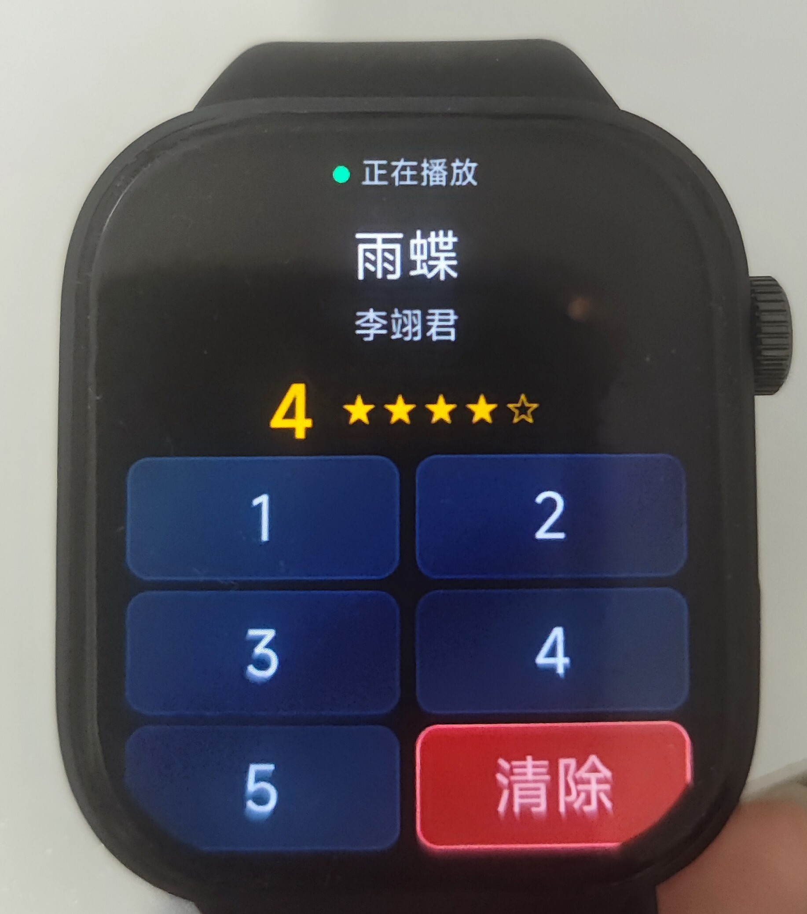
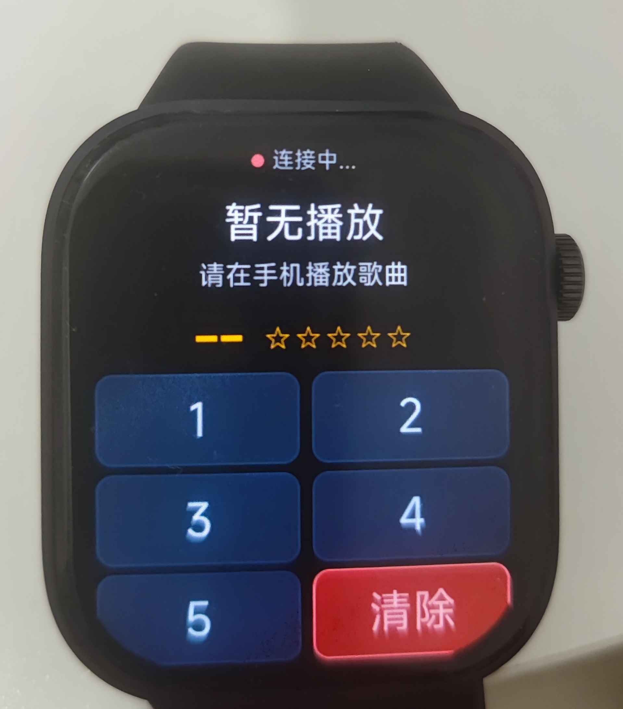

# Subsonic Remote for Xiaomi Vela (Redmi Watch 6 / Smart Band)

轻量级小米澎湃 OS (Xiaomi Vela) 智能手表/手环快应用，为 Navidrome / Subsonic 私有音乐服务器提供手腕端的实时曲目信息显示与 0~5 星快捷评分功能。

<p align="center">
  
  &nbsp;&nbsp;&nbsp;&nbsp;
  
</p>
<p align="center"><em>红米手表 6 (Redmi Watch 6 / Xiaomi Vela) 真机实拍效果</em></p>

---

## ⌚ 核心特性

- **纯 JS 实现 MD5 认证**：Vela 运行时基于轻量级 QuickJS，无 Node.js `crypto` 原生模块。本项目手写纯 JS MD5 算法，完美适配 Subsonic 现代 MD5 `salt + token` 动态认证。
- **实时曲目与评分监听**：自动轮询 `getNowPlaying`（默认 15 秒省电周期），支持多用户环境过滤当前用户的播放流。
- **实时星级同步**：采用 `getSong` 解决快照评分滞后问题；支持 1~5 星快速打分与取消评分（0 星）。
- **极简大触控面积 UI**：针对手表小屏幕深度优化的 3 行 2 列大按钮触控网格，防止误触。
- **凭据彻底解耦**：服务端 URL、用户名与密码独立存放于 `config.js`，受 `.gitignore` 保护，杜绝敏感信息泄漏。

---

## 🛠️ 项目结构

```
subsonic-rating-vela/
├── assets/                              # 真机运行实拍与演示图片
│   ├── device_playing.jpg
│   └── device_connecting.jpg
├── src/
│   ├── app.ux                           # 应用全局生命周期与配置装载
│   ├── manifest.json                    # 小米 Vela 快应用清单配置
│   ├── common/
│   │   ├── images/logo.png              # 表盘应用图标
│   │   └── scripts/
│   │       ├── config.example.js        # 凭据配置模板
│   │       └── subsonic.js              # 纯 JS MD5 与 Subsonic API 交互封装
│   └── pages/
│       └── index/                       # 主打分界面 (index.ux)
├── sign/                                # 签名证书目录（受 .gitignore 保护）
├── DEVELOPMENT-NOTES.md                 # 架构演进与开发日志
└── package.json
```

---

## 🚀 快速上手与构建

### 1. 配置服务端连接

复制配置模板：
```bash
cp src/common/scripts/config.example.js src/common/scripts/config.js
```

编辑 `src/common/scripts/config.js`，填入你的 Subsonic / Navidrome 服务端信息：
```javascript
export default {
  serverUrl: 'https://your-navidrome-server.com',
  username: 'your-username',
  password: 'your-password',
  pollInterval: 5000
}
```

### 2. 生成自签名证书 (首次构建)

Vela 打包需要自签名密钥对：
```bash
mkdir -p sign
openssl req -newkey rsa:2048 -nodes -keyout sign/private.pem -x509 -days 3650 -out sign/certificate.pem -subj "/CN=Subsonic Remote/O=Personal"
```

### 3. 安装依赖并编译

```bash
# 安装依赖
npm install

# 构建开发包 (产物在 dist/ 目录下，扩展名为 .debug.rpk)
npm run build

# 构建正式发布包 (产物在 dist/ 目录下，扩展名为 .release.rpk)
npm run release
```

---

## 📲 手表安装与侧载
 
编译完成后，将 `dist/` 目录下生成的 `.rpk` 文件（建议使用 release 版本）传输并通过适用的快应用侧载工具安装至手表即可。

> ⚠️ **安全提示**：由于 Vela 快应用机制会将 `config.js` 编译打包进 `.rpk` 文件中，请勿将自己编译生成的 `.rpk` 安装包直接分享或发布到公开平台，避免服务端账号密码外泄。建议使用者拉取源码后自行配置并编译。

---

## 📄 License

GPL-3.0-or-later. See [LICENSE](LICENSE) for details.
